# Bangkok Airbnb, 2024 to 2026: an SQL analysis

Inside Airbnb scrapes Bangkok roughly once a month. I took all 24 snapshots from September 2024 to September 2026 (there is no May 2026 one): about 650,000 listing rows, 720,000 review dates and 11 million calendar days. Then I worked through four questions in SQL:

1. How booked are Bangkok listings, and where?
2. How do prices differ by district once you compare like with like?
3. Who are the big hosts?
4. What changed month to month?

If you're picking where to stay, the district prices and the seasonality chart are the useful parts. If you're weighing up a condo to let, read the nightly vs monthly section and the limits at the end first.

**[Interactive dashboard](https://omidakrami.github.io/bangkok-airbnb-data-useful-for-travel-investment/)** · [Kaggle notebook](https://www.kaggle.com/code/omidakrami/bangkok-airbnb-2024-2026-analysis-in-sql) · [Kaggle dataset](https://www.kaggle.com/datasets/omidakrami/bangkok-airbnb-monthly-snapshots) · [SQL files](sql/) · [Query outputs](results/)

[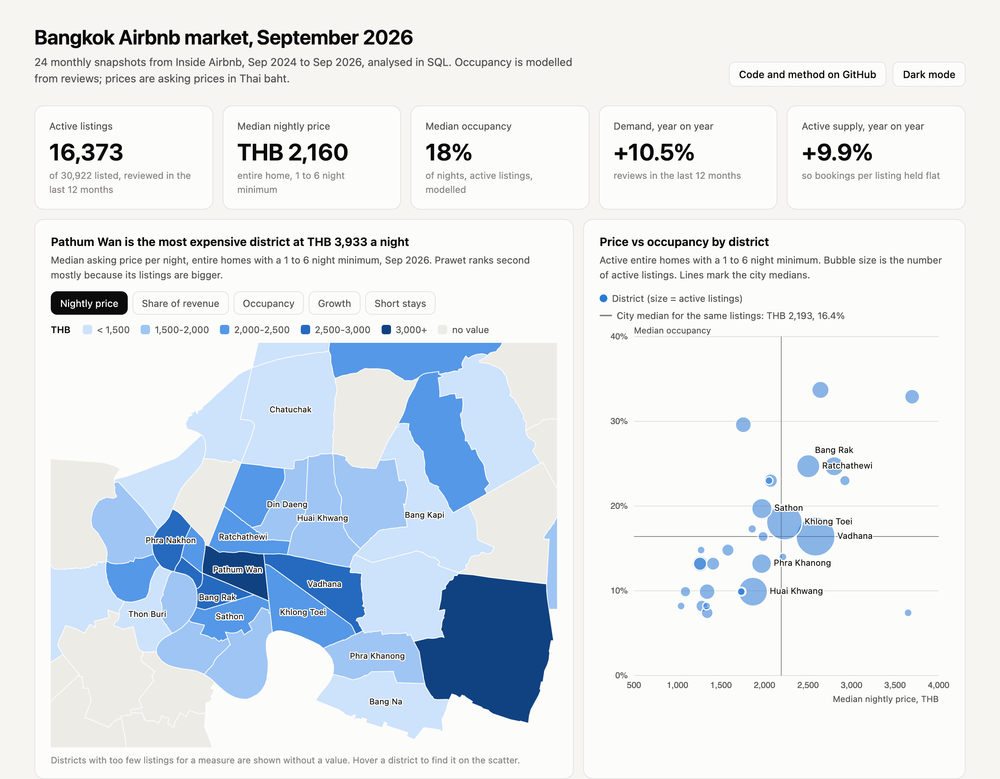](https://omidakrami.github.io/bangkok-airbnb-data-useful-for-travel-investment/)

It runs on DuckDB. The analysis files are written to be mostly portable, but they do use a few DuckDB conveniences (`median()`, `bool_or()`, `generate_series`, `arg_max`) that would need swapping on Postgres or BigQuery.

---

## What I found

Figures are from the September 2026 snapshot unless a date is given. Each links to the query output it came from.

### Occupancy

- The median active listing (one or more reviews in the last 12 months) is booked about 18% of nights, roughly 66 a year. For entire homes it's 23%. ([occ_summary](results/occ_summary.csv))
- The spread is wide. 22% of active listings are booked less than 5% of the year, and the top 10% of listings take 42% of estimated revenue. ([occ_distribution](results/occ_distribution.csv), [occ_revenue_deciles](results/occ_revenue_deciles.csv))
- Vadhana and Khlong Toei, the two Sukhumvit districts, account for 42% of the city's estimated Airbnb revenue. ([occ_by_district](results/occ_by_district.csv))

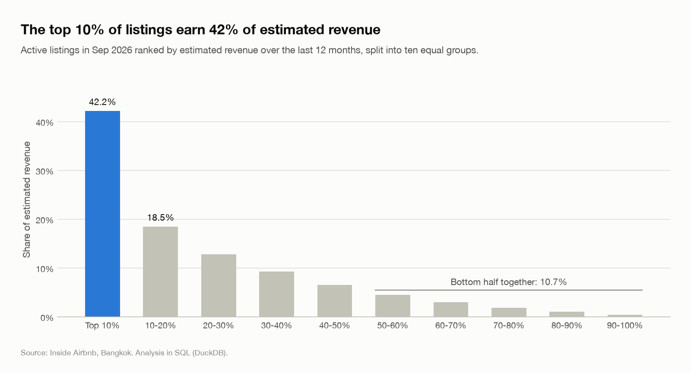

### Prices by area

These use entire homes with a minimum stay of 1 to 6 nights. Weekly and monthly lets are kept out because their quoted per-night price is a discounted rate (more on that below).

- City median: ฿2,160 a night. Among districts with 30+ listings, Pathum Wan is the most expensive at ฿3,933 (+82%). The cheapest are Lak Si (฿1,090) and Bang Kapi (฿1,188). ([price_by_district](results/price_by_district.csv))

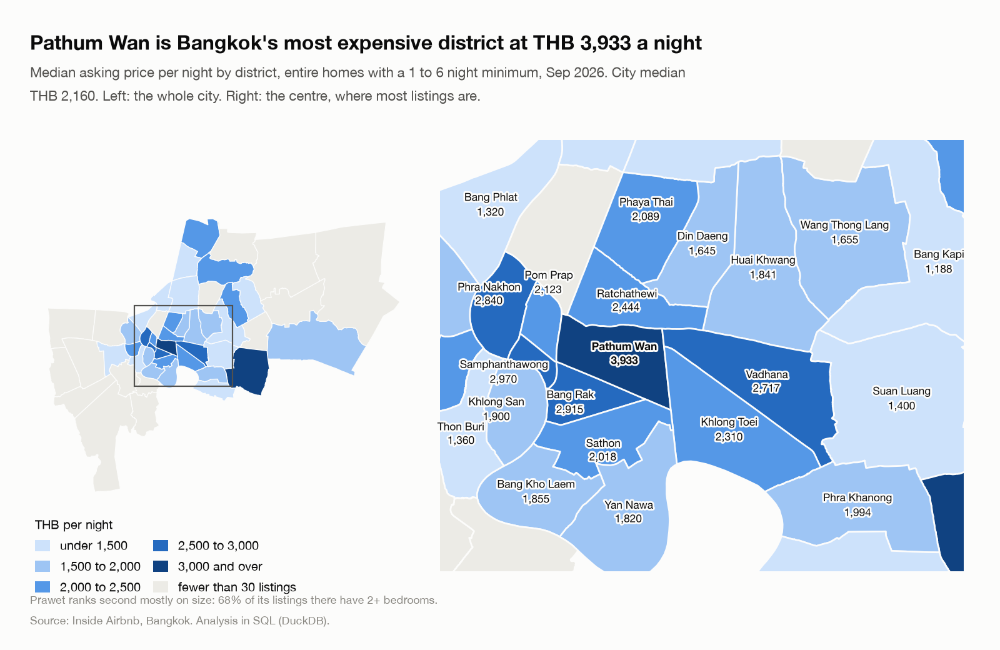

<details>
<summary>All 34 districts with 30+ listings, with the middle 50% of prices</summary>

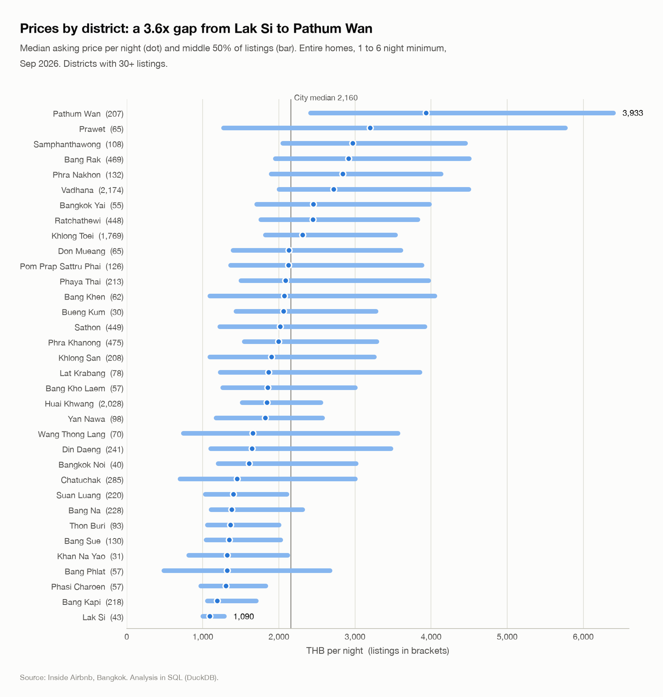

</details>
- Some of that gap is unit mix. Two thirds of Pathum Wan's listings have 2+ bedrooms. Comparing 1-beds only, Pathum Wan vs Bang Na goes from 2.9x to 2.4x. ([price_district_by_size](results/price_district_by_size.csv))
- Cheaper listings don't get booked more. The cheapest tenth of listings is booked a median 13% of the year, the middle of the market about 20%, the most expensive tenth 13% again. Low prices may also mean lower quality, so this doesn't prove price cuts don't work, but there's no sign of it here. ([price_bands_vs_performance](results/price_bands_vs_performance.csv))
- Listings with a pool price 4% higher in a straight comparison and about 28% higher inside the same district, bedroom count and property type. I don't read that as the value of the pool. In Bangkok a pool mostly means a newer condo tower. Listings with a gym price about 8% higher by the same method. ([price_amenity_premium](results/price_amenity_premium.csv))

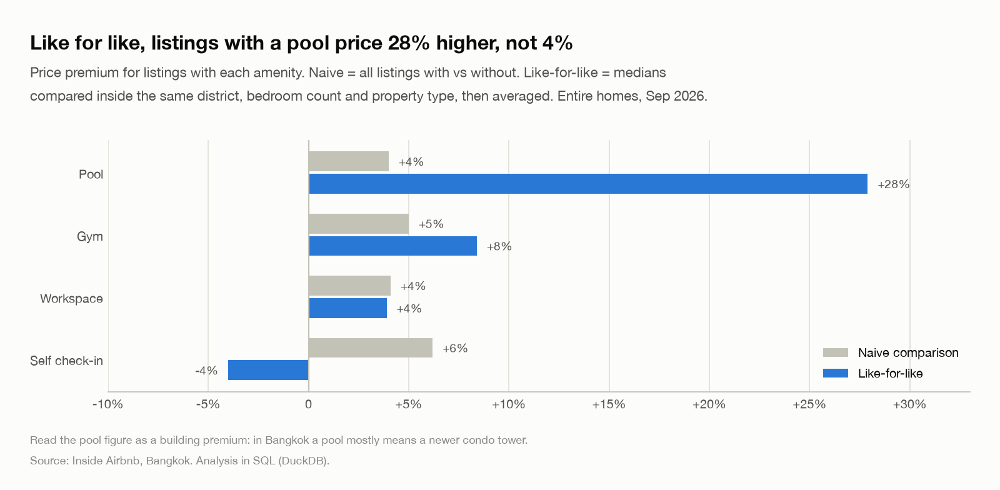

### Nightly letting vs renting by the month

The question an owner of a 1-bed condo would ask. In 13 of the 15 districts with enough of both, monthly 1-beds are priced 28% to 51% below the nightly rate x 30. So a nightly let needs 50% to 72% occupancy just to match a unit let by the month all year, before cleaning, platform fees or utilities. The median nightly 1-bed in those districts runs at 7% to 27%. Counting each listing at its own price, between 2% and 24% of active nightly 1-beds out-earn a year of the district's median monthly rent. ([price_short_vs_monthly](results/price_short_vs_monthly.csv))

In Chatuchak and Bang Phlat the monthly 1-beds are actually pricier per night than the nightly ones. Different stock, so the comparison doesn't work there.

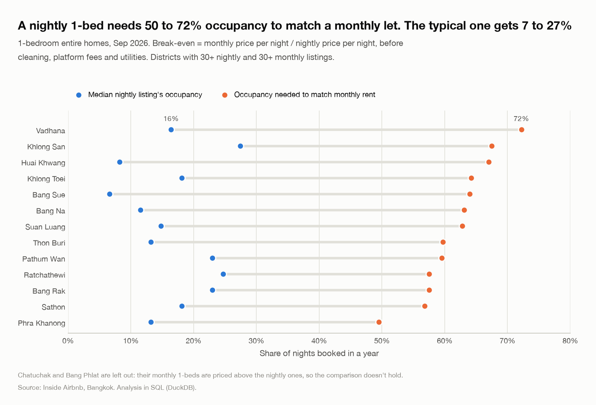

### Hosts

- 7,989 host accounts. The top 1% of them hold 21% of listings, and the top 1% by revenue earn 30% of it. Gini coefficient on listings per host: 0.63. ([host_concentration](results/host_concentration.csv))
- Most districts are fragmented. In the core districts (Vadhana, Khlong Toei, Huai Khwang, Ratchathewi) the biggest account has under 4% of active listings. Two outer districts are different: one account runs 52% of Saphan Sung's active listings and another 31% of Bang Phlat's. All of this is per account, and some companies run several. ([host_district_hhi](results/host_district_hhi.csv))
- The 17 accounts with 100+ listings hold 8% of all listings, but two thirds of those listings had no review in a year. On active listings they're 5% of supply and 5% of revenue, and their typical active listing is booked 16% of the year vs 22% for single-listing hosts. ([host_tiers](results/host_tiers.csv), [host_top](results/host_top.csv))
- Superhosts charge about 10% more and run 13 points higher occupancy than other hosts in the same district and room type. Superhost status is partly earned by being booked, so that's correlation. ([host_superhost_effect](results/host_superhost_effect.csv))

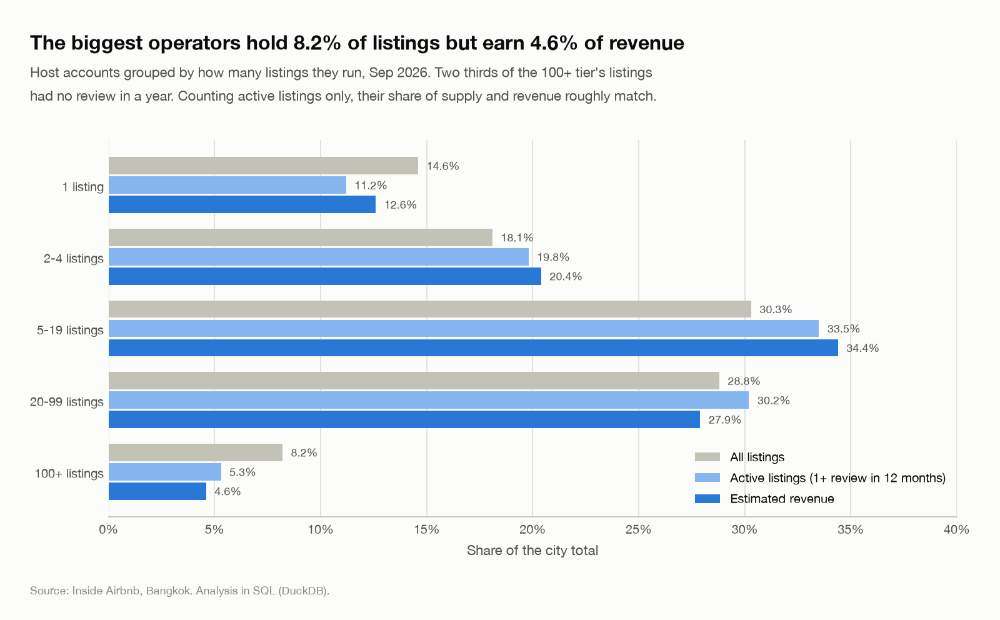

### Month over month

- Demand, measured as reviews in the trailing 12 months, is up 10.5% on a year ago. Active listings are up 9.9%. Reviews per active listing went from 11.3 to 11.4, so the extra demand was absorbed by extra supply. ([trend_demand_ltm](results/trend_demand_ltm.csv), [trend_occupancy](results/trend_occupancy.csv), [kpis](dashboard/kpis.csv))

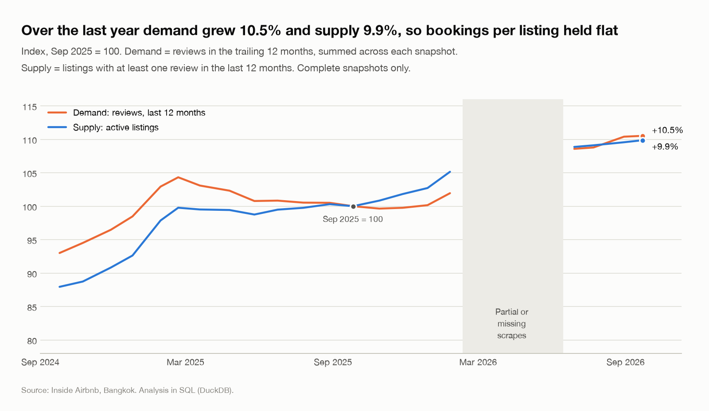

- Modelled occupancy steps down in December 2025 and stays lower. That's the model reacting to minimum stays: 2,035 active listings cut their minimum that month (264 the month before), and the model multiplies reviews by minimum nights. Reviews per listing didn't drop. ([trend_occupancy](results/trend_occupancy.csv), [trend_min_stay_changes](results/trend_min_stay_changes.csv))
- Seasonality, after removing the growth trend: January runs 29% above an average month, December and February 17 to 18% above. September is the low point at 21% below. ([trend_seasonality](results/trend_seasonality.csv))

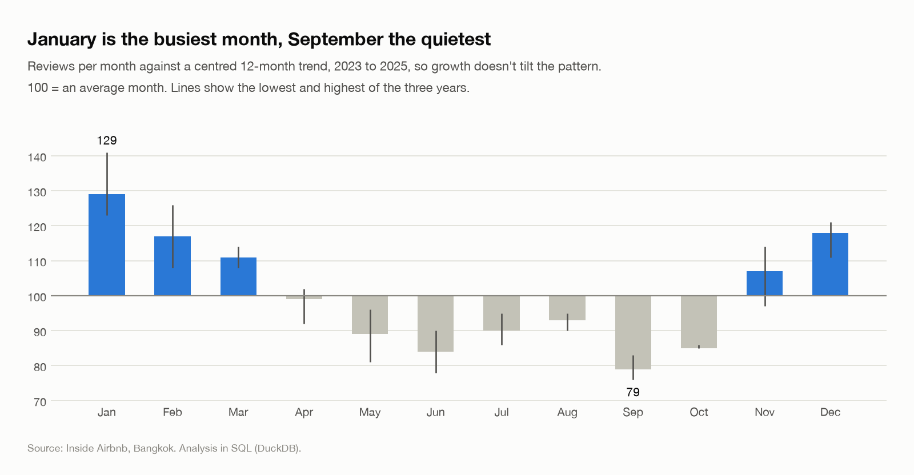

- Asking prices move with it. On a same-listing basis they rose 23% from late September to late December 2024 and were back to the starting level by April. From June to September 2026 they were flat (-0.6%). ([trend_price_index](results/trend_price_index.csv))

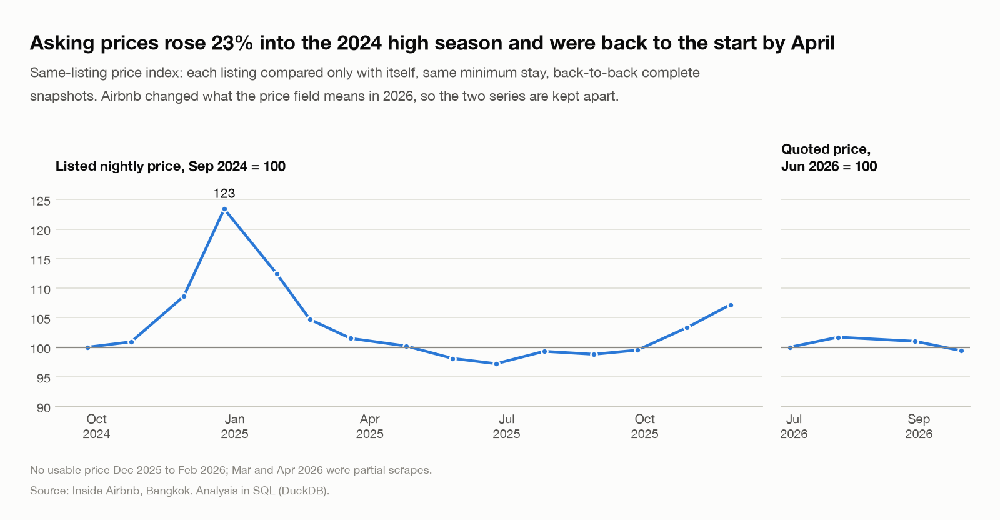

- Of the listings that first appear in a given month, 74 to 83% are still listed 3 months later and 53 to 64% a year later. ([trend_cohort_retention](results/trend_cohort_retention.csv))
- District growth doesn't follow a simple centre vs outskirts pattern. Among districts with 100+ active listings a year earlier, the biggest movers are Thon Buri +66% (one host has 36 of the 180 listings that became active there), Samphanthawong +34% and Bang Na +30%. Bang Phlat (-11%), Bang Sue (-9%) and Suan Luang (-8%) shrank, and so did central Pathum Wan, Phra Nakhon and Sathon (-3% to -5%). ([trend_district_growth](results/trend_district_growth.csv), [trend_district_new_listings](results/trend_district_new_listings.csv))

### Stays under 30 nights

83% of entire homes accept stays shorter than 30 nights, and the share has been between 81% and 85% in every full snapshot for two years. Thailand's Hotel Act treats short lets of residential units without a hotel licence as non-compliant. The licence field is empty for every Bangkok listing, so this measures exposure; it can't say who is licensed. ([stay_by_room_type](results/stay_by_room_type.csv), [stay_trend](results/stay_trend.csv), [stay_by_district](results/stay_by_district.csv))

---

## The data, and what's wrong with it

Most of the time on this went into working out which numbers hold up. The checks are views in [`02_data_quality.sql`](sql/02_data_quality.sql).

**Three partial snapshots.** February, March and April 2026 have 25k, 16k and 17k listings against 30k either side. Of the 10,271 listings that disappear between February and March, 8,973 show up again later ([dq_dropouts](results/dq_dropouts.csv)). Two checks catch this. "Holes" counts listings seen before and after a snapshot but missing from it: a few hundred in a normal month, 4,000 to 12,000 in these three. And the share of the previous month's listings still present is 95 to 98% normally and 77%, 59% and 89% for these. They're flagged `is_complete = false`. Changes and year-on-year figures skip them; views that list every month keep them as flagged rows. ([dq_snapshot_coverage](results/dq_snapshot_coverage.csv))

**The partial scrapes are skewed.** March and April 2026 contain 6 and 1 listings with a 30+ night minimum, against around 13 to 15% of listings in every full snapshot. ([dq_partial_scrape_profile](results/dq_partial_scrape_profile.csv))

**Dormant listings drop out from February 2026.** Until January every snapshot had around 3,000 listings with a calendar blocked all year and no reviews. Afterwards, around 800. 73% of the 3,359 listings last seen in January 2026 were fully blocked; for any other month's leavers it's 2 to 15%. My first host chart showed hosts with 10+ listings jumping from 46% to 51% of supply between January and June 2026, and about half of that was this. Trends that cross February 2026 use active listings. Even then, the 10+ host share sits at 41 to 43% for 16 months and steps to 44.5% across the gap, which I can't separate from scrape changes. ([dq_dormant_listings](results/dq_dormant_listings.csv), [host_pro_share_trend](results/host_pro_share_trend.csv))

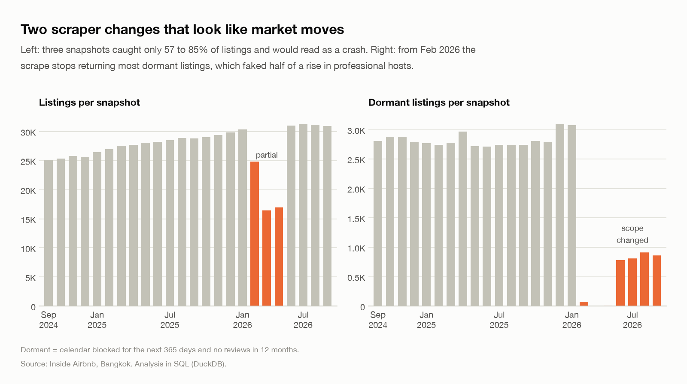

**Price means two different things.** Until November 2025 `price` is the listed nightly price. December 2025 to February 2026 have no price. From March 2026 it's a quote for a stay of `min_nights` starting a few days out (true for 94% of listings). So a 7-night minimum shows a weekly per-night rate and a 30-night minimum a monthly one. 38% of entire-home 1-beds that accept stays under 30 nights have a 7 to 29 night minimum, which is why pricing uses 1 to 6 night listings. The two price series are never compared with each other. ([dq_quote_window](results/dq_quote_window.csv), [price_city_overview](results/price_city_overview.csv))

**Survivorship in the reviews file.** It only has reviews for listings still listed in September 2026. Listings that left since September 2024 took about 155,000 reviews with them, at least 18% of the history (more left before 2024). Measured from the reviews file, demand grew 24% in a year. Summing `reviews_ltm` across each snapshot, which counts listings that later disappeared, gives 10.5%. The second is the less biased number. ([trend_growth_two_ways](results/trend_growth_two_ways.csv))

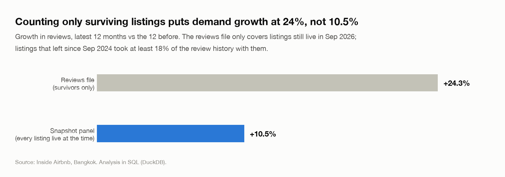

Smaller things: the `$` in prices is formatting and the values are THB. `host_since` stops being published in December 2025. The raw `bathrooms` column is empty in September 2026, so staging parses `bathrooms_text` instead. 955 price rows across all snapshots (41 in the latest) fall outside ฿200 to ฿100,000; some hosts park listings at ฿1,000,000 to block bookings. They're flagged and excluded from price figures. A few district names in the data are Inside Airbnb's own spellings (Parthum Wan, Chatu Chak, Suanluang); the charts and the text use the usual ones.

---

## How occupancy is estimated

Airbnb doesn't publish bookings, so I used Inside Airbnb's "San Francisco model":

```
nights booked (last 12 months) = reviews_ltm / 0.5 * max(3, min_nights), capped at 255
```

0.5 is the assumed share of guests who leave a review, 3 nights the assumed stay, 255 nights a 70% cap. I wrote it from their methodology page and then checked it against the `estimated_occupancy_l365d` column they publish: all 30,922 listings match exactly.
([occ_model_check](results/occ_model_check.csv))

It's a rough model, better for ranking than for absolute levels. It's also sensitive to minimum stay, as the December 2025 step shows. As a cross-check I compared it with the forward calendar for the November 2026 to February 2027 high season: across 38 districts the two rank districts with a Spearman correlation of 0.61. ([occ_method_agreement](results/occ_method_agreement.csv))

---

## Repo layout

```
sql/
  00_load.sql              raw files into DuckDB as text
  01_staging.sql           types, cleaning rules, snapshot coverage checks
  02_data_quality.sql      the checks above, as views
  03_occupancy.sql         occupancy model, distribution, districts, forward calendar
  04_pricing_by_area.sql   district prices, size mix, amenities, nightly vs monthly
  05_hosts.sql             tiers, top hosts, concentration (Gini, HHI), handovers
  06_trends.sql            reviews MoM/YoY, seasonality, supply, price index, cohorts
  07_short_stays.sql       stays under 30 nights
  08_dashboard.sql         flat tables for the dashboard
results/                   output of every analysis view (csv)
dashboard/                 dashboard extracts and district boundaries (geojson)
charts/                    the charts in this README
docs/                      the dashboard page, served by GitHub Pages
notebooks/                 the Kaggle notebook
scripts/                   download, build, charts, dashboard data, export for Kaggle
```

## Run it

```bash
pip install -r requirements.txt
./scripts/download_data.sh             # ~450 MB from Inside Airbnb
python scripts/build.py                # under a minute, writes results/ and dashboard/
python scripts/make_charts.py          # charts/*.png
python scripts/make_dashboard_data.py  # docs/data.js for the dashboard
```

`build.py` runs the SQL files in order and exports every view starting with `dq_`, `occ_`, `price_`, `host_`, `trend_` or `stay_` to `results/`, and every `dash_` view to `dashboard/`. The chart and dashboard scripts only read those CSVs, so they work without the raw data.

To view the dashboard locally: `python -m http.server --directory docs` and open http://localhost:8000.

## Limits

- Occupancy is modelled (see above) and capped at 70%.
- The calendar can't tell a booked night from a night the host blocked.
- Prices are asking prices before fees, not what guests paid.
- Airbnb shifts listing coordinates by up to about 150 m. Fine at district level.
- "Host" means a host account. Host names are only shown for accounts with 20+ listings.
- The latest snapshot can't be checked for holes (nothing comes after it), only against the month before.

## Data

[Inside Airbnb](https://insideairbnb.com/get-the-data/), Bangkok, snapshots 2024-09-25 to 2026-09-22, licensed CC BY 4.0. Reviewer names and review text are never loaded.

Code is MIT licensed (see [LICENSE](LICENSE)). The data and anything derived from it stay under Inside Airbnb's CC BY 4.0 licence.
